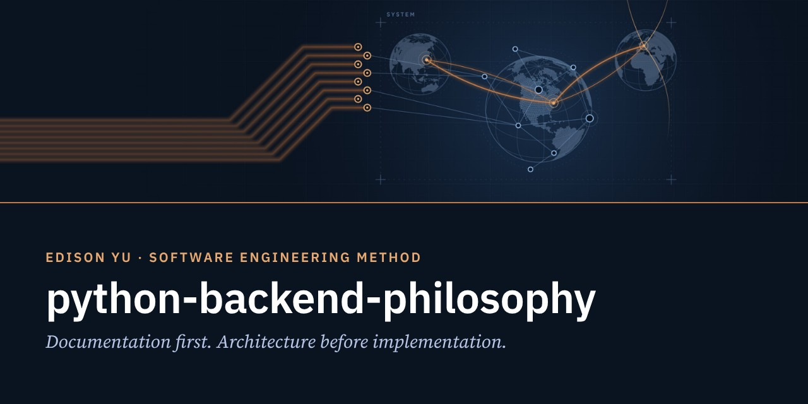
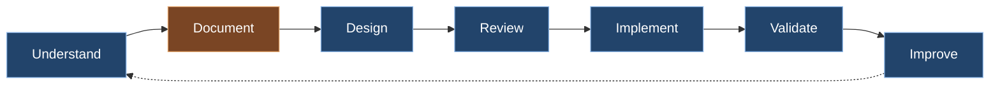
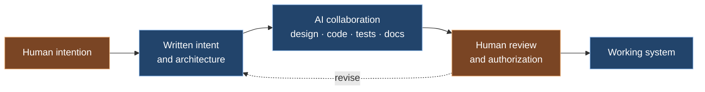

  

# The Python & Backend Philosophy

**How I approach software engineering.**
Documentation-First Development · Architecture Before Implementation · AI-Assisted Engineering

> The technology was different. The engineering principles were the same.

---

## Purpose

**Why it exists.** To show how I engineer software: the method, the habits, and the reasons behind them.

**What problem it solves.** Most project failures are not caused by technology limitations. They are caused by unclear requirements, insufficient architecture, poor documentation, a lack of systems thinking, and excessive complexity. This repository describes the method that answers them.

**How it fits the ecosystem.** It is the software-engineering companion to [Engineering Philosophy™](https://www.yugeniuslab.com/engineering-philosopher/), and the method behind [yu-genius-lab-backend](https://github.com/ilsooedisonyu/yu-genius-lab-backend). The full essay is at [yugeniuslab.com/publications/python-backend-philosophy](https://www.yugeniuslab.com/publications/python-backend-philosophy/).

## Identity

| Year | Milestone |
|---|---|
| 2007 | First exposure to Python, brought straight into a semiconductor validation workflow |
| 2017 – 2019 | Teaching Python to students, on evenings and weekends |
| 2021 | Django backend development, a personal engineering initiative |
| 2026 | Multi-AI engineering collaboration and the formation of GOE Lab |

> Technology should simplify complexity, not create it.

## Architecture: the method

### Architecture before implementation

Before writing code, the system must be understood.
Before optimization, structure must be correct.
Before selecting technology, the problem must be clearly defined.

### Flow: documentation-first development

Documentation serves as the bridge between ideas, architecture, implementation, and future maintenance.

### AI-assisted development

AI assists. Human intention remains the source.

AI collaboration did not replace engineering judgment. It amplified it. Over the last two years, AI-assisted engineering substantially increased my ability to learn, research, document, evaluate architectures, develop software, and explore new ideas. The result was not incremental productivity improvement. The result was a fundamentally expanded engineering capability.

### What teaching taught

- Simplicity is often harder than complexity.
- Clear explanations are more valuable than clever solutions.
- Good systems are understandable by others.
- Engineering is ultimately about communication.

### Engineering leadership through clarity

Many organizational challenges are ultimately systems problems. Many systems problems are ultimately clarity problems.

## Relationship to GOE

GOE Lab, Edison Yu's Personal Lab, is where this method is practiced: Django backend development, full-stack systems, Multi-AI engineering collaboration, architecture-driven design, documentation-first development, human-centered technology, and systems thinking.

## Relationship to Yu Genius Lab

Yu Genius Lab publishes knowledge. This method is how the platform behind it is built and maintained.

## Vocabulary

| Term | Meaning |
|---|---|
| Documentation-first development | Understand → Document → Design → Review → Implement → Validate → Improve |
| Architecture before implementation | Understanding the system, its structure, and the problem before writing code |
| Multi-AI engineering collaboration | Several AI systems working on architecture, documentation, development, testing, and deployment under human direction |

## Future Direction

Technical essays on backend engineering practice and AI-assisted development are added here after they are published on the website.

## References

- [The Python & Backend Philosophy](https://www.yugeniuslab.com/publications/python-backend-philosophy/)
- [Engineering Philosophy™](https://www.yugeniuslab.com/engineering-philosopher/)
- [GOE Lab™](https://www.yugeniuslab.com/goe-lab/)

---

© 2026 Edison Yu. All rights reserved. You may read, link to, and quote short excerpts with attribution. · Engineering Repository™ · Revision 2026.70
